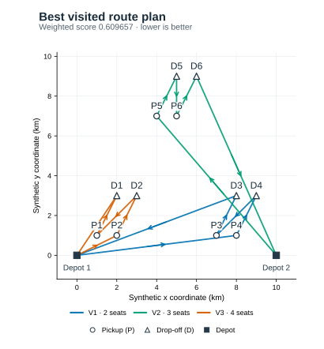

# Customized Shuttle Bus Route Planning

Plan shuttle-bus routes that pick up and drop off passengers within specified time windows. The software supports multiple depots and vehicles with different seating capacities, using **Adaptive Large Neighborhood Search (ALNS)** and **Tabu Search** to improve a supplied route plan.

The default workflow serves one passenger per request and returns each vehicle to its starting depot. The associated [research paper](https://doi.org/10.3390/info12100429) studies customized shuttle transit under uneven demand and short surges in passenger volume.

[Quick start](#quick-start) · [Example](#example) · [Model](docs/MODEL.md) · [Algorithm](docs/ALGORITHM.md) · [Data and options](docs/DATA.md)

## Quick start

Download or clone this repository. Open MATLAB or GNU Octave and set the current folder to the directory containing `run_demo.m`, then run:

```matlab
result = run_demo;
```

The example creates **six passenger requests, three vehicles with 2/3/4 seats, and two depots**. It uses base MATLAB functions and needs no spreadsheets or Python installation.

- **MATLAB syntax target:** R2016b or newer.
- **Verified runtime:** GNU Octave 11.3.0 on Windows.
- **Outputs:** `result.bestCost`, `result.bestSolution` and files in `results/demo/`.

## Example

The default run uses seed 7, five iterations and three candidate plans per iteration, with transfers disabled. The following values come from the verified GNU Octave run.

| Initial score | Best visited score | Requests served | Vehicles used |
| ---: | ---: | ---: | ---: |
| 0.691171 | 0.609657 | 6 / 6 | 3 |

**Lower score is better.** The [weighted objective](docs/MODEL.md#objective) combines vehicle costs, waiting and service-quality penalties, including deviations from preferred pickup and delivery times.



`Pi` and `Di` mark the pickup and drop-off of request `i`. Squares mark depots, colors distinguish vehicles, and arrows show travel direction. Coordinates are synthetic.

See the [complete example](examples/README.md) for initial and best-found routes, score components and downloadable outputs.

## How the search works

A request is one passenger's pickup–drop-off pair. A candidate plan is a set of vehicle routes.

1. Load a feasible starting plan and calculate its score.
2. Select two routes and remove selected requests or request groups.
3. Reinsert those requests into the two routes, checking capacity, visit order and time windows.
4. Select a candidate using tabu memory; a move that improves the best score can override the tabu rule.
5. Update the best plan and the operator-selection weights, then repeat.

Five removal operators and two insertion operators—random-start and greedy—are provided. The [algorithm guide](docs/ALGORITHM.md) explains their behavior, the stopping rule and the optional [transfer-candidate interface](docs/MODEL.md#transfer-candidate-interface).

## Inputs and entry points

`MDVRPTW` accepts an instance structure or MAT-file path. Its starting routes define the set of requests to optimize. The [data guide](docs/DATA.md) covers node IDs, time units, file formats, solver options and saving or reloading a run.

| Entry | Purpose |
| --- | --- |
| [run_demo.m](run_demo.m) | Run the six-request example |
| [make_demo_instance.m](make_demo_instance.m) | Create or adapt the example's explicit inputs |
| [MDVRPTW.m](MDVRPTW.m) | Optimize a supplied route plan |
| [Model reference](docs/MODEL.md) | Constraints, timing and objective |
| [Algorithm guide](docs/ALGORITHM.md) | Search flow and function index |
| [Additional routines](legacy/README.md) | Alternate operators and data utilities |

The included `initial0805_concentrate.mat` is an evaluation input with 500 requests and 170 vehicles. Its stored routes cover 396 requests. To inspect its score and constraint report:

```matlab
snapshot = MDVRPTW([],struct('MaxIterations',0));
```

Optimization requires a feasible starting plan. Add only the repository root to the MATLAB path; keep `legacy/` off the executable path.

## Results reported in the paper

These values are reported in **Tables 5 and 7 of the article**.

| Demand pattern | Transfers | Passengers | Vehicles | Total cost |
| --- | --- | ---: | ---: | ---: |
| Centralized, temporally scattered | No | 488 | 168 | 81,418.72 |
| Centralized, temporally scattered | Yes | 488 | 159 | 76,209.29 |
| Centralized, super-peak | No | 538 | 326 | 121,587.18 |
| Centralized, super-peak | Yes | 540 | 298 | 111,011.54 |
| Spatially and temporally scattered | No | 396 | 153 | 77,595.96 |
| Spatially and temporally scattered | Yes | 396 | 153 | 74,534.88 |

These cost totals belong to the article's experiments. The synthetic example above reports the weighted solver score.

## Tests

From the repository root:

```matlab
addpath('tests');
run_tests;
```

The tests cover request coverage, loads, visit order, timing, objective calculations, tabu selection, data loading and a short search.

## Citation

Hao Zheng, Xingchen Zhang and Junhua Chen. **Study on Customized Shuttle Transit Mode Responding to Spatiotemporal Inhomogeneous Demand in Super-Peak.** *Information* 12(10), 429 (2021). [DOI: 10.3390/info12100429](https://doi.org/10.3390/info12100429).

```bibtex
@article{zheng2021customized,
  author  = {Zheng, Hao and Zhang, Xingchen and Chen, Junhua},
  title   = {Study on Customized Shuttle Transit Mode Responding to
             Spatiotemporal Inhomogeneous Demand in Super-Peak},
  journal = {Information},
  year    = {2021},
  volume  = {12},
  number  = {10},
  pages   = {429},
  doi     = {10.3390/info12100429}
}
```

Machine-readable citation metadata is available in [CITATION.cff](CITATION.cff).
