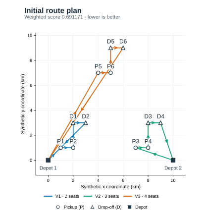
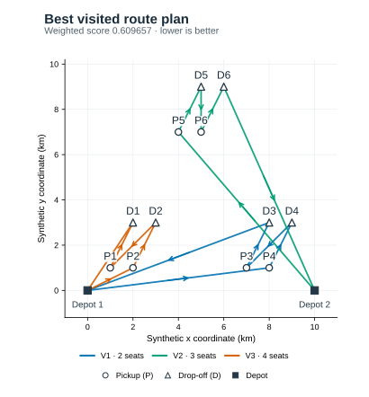

# Six-request example

This example starts with six passenger requests, three vehicles with capacities of 2, 3 and 4, and two depots. Each request has one pickup and one drop-off. Coordinates are synthetic, travel takes two minutes per kilometre, and every vehicle returns to its starting depot. Transfers are disabled.

## Run the example

From the repository root:

```matlab
result = run_demo;
```

The default configuration is **seed 7, five iterations and three candidate plans per iteration**. The outputs below were verified with GNU Octave 11.3.0 on Windows. Random sequences may differ between runtimes.

The command saves the input as `results/demo/instance.mat`, the result as `result.mat`, and two CSV files. See [saving and reloading](../docs/DATA.md#saving-and-reloading) to reuse them.

## Read the result

**Lower score is better.** The score combines cost terms with service-quality penalties. All six requests remain served by three vehicles, and the route constraints pass.

| Score component | Initial | Best visited |
| --- | ---: | ---: |
| Cost terms | 0.097304 | 0.118600 |
| Service-quality terms | 0.593868 | 0.491057 |
| **Total score** | **0.691171** | **0.609657** |

The selected plan has higher cost terms and lower service-quality penalties, giving a lower total score. The two components are `C/1000` and `Q/1000` in the [objective definition](../docs/MODEL.md#objective). Their full values are available in [result.json](result.json).

`Pi` is the pickup of request `i`; `Di` is its drop-off. For example, `P4 → D4 → P3 → D3` serves request 4 and then request 3. Each route starts and ends at its assigned depot.

| Vehicle | Depot | Best visited route |
| --- | --- | --- |
| V1 | Depot 1 | `P4 → D4 → P3 → D3` |
| V2 | Depot 2 | `P5 → D5 → P6 → D6` |
| V3 | Depot 1 | `P2 → D2 → P1 → D1` |

In the MATLAB route arrays, pickups are nodes `1:6` and drop-offs are `7:12`: `D4` is node 10. Depot visits are implicit.

## Route maps

The two maps share the same coordinates and vehicle colors. Circles are pickups, triangles are drop-offs, squares are depots, and arrows show travel direction.





These figures come from the saved input and result MAT files. The article's experiments are listed separately in the [project README](../README.md#results-reported-in-the-paper).

## Output files

- [Result and configuration](result.json), including initial and best objective components.
- [Objective history](history.csv): iteration, current score and best score.
- [Route visits](routes.csv): vehicle, position and node.

The CSV files in this directory include column headers. The solver's `results/demo/history.csv` contains the same three columns without a header.

To regenerate both route maps after running the example:

```sh
python scripts/plot_demo.py
```

Plotting requires NumPy, SciPy and Matplotlib. The solver itself uses base MATLAB functions. Both maps are exported as SVG and PNG.
